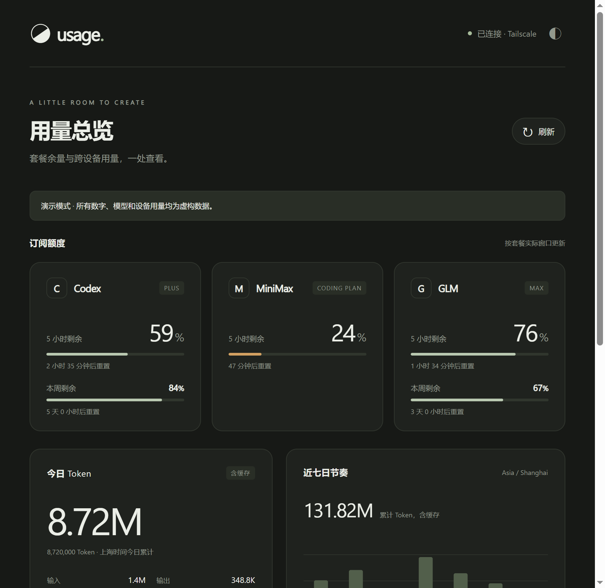
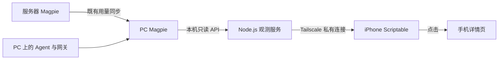

# ScriptableTokenWidgets

让 iPhone 桌面显示 **Codex Plus、MiniMax、GLM 的套餐余量与真实 Token 用量**。数据直接来自 Magpie，保持它已有的跨设备同步与统计口径。

黑白灰、细进度条、少量状态色。一个中号组件，默认三家订阅（数量与顺序在 PC 端配置）；点击进入手机详情页。

> 预览使用虚构演示数据，不代表真实账号、模型价格或套餐消耗。



## 如何工作



- 所选套餐的剩余比例、5 小时／周额度窗口与重置时间，以 Magpie 实际返回为准。
- 今日 Token、七日趋势、模型排行和两端设备用量，包含 Magpie 已识别的原生 Agent 日志。模型与厂商条目来自实际用量，新增模型无需改代码。
- Token 为输入＋输出＋缓存读取＋缓存写入；推理用量单列，已含在输出中。
- 深浅色自适应；网页也可手动切换。断网保留最后结果，窗口到期不会伪造新额度。
- 后端每分钟汇总，组件申请约五分钟刷新，实际由 iOS 调度。
- 无第三方运行依赖，无 Docker、n8n、数据库或公网入口。

## 在 PC 安装

需要 Windows、Node.js 22+、已运行的 Magpie，以及已连接的 Tailscale。PC 与 iPhone 必须能按你的 Tailnet 访问规则互通。

在当前用户的 PowerShell 中执行：

```powershell
git clone https://github.com/liuzq1103/ScriptableTokenWidgets.git
cd ScriptableTokenWidgets
powershell -NoProfile -ExecutionPolicy Bypass -File scripts/install.ps1
```

安装器会生成独立只读令牌，创建隐藏运行的当前用户登录任务，并配置仅在 Tailnet 内可用的 TCP 转发。它不会改动 Magpie 配置或订阅登录。该转发无需 HTTPS 域名或 Windows 防火墙管理员权限；其他 Serve 端口保持原样。

**连接地址和令牌位于 `.local/iphone-setup.txt`。请在本地打开，不要上传到 GitHub。**

## 在 iPhone 安装

1. 安装 [Scriptable](https://scriptable.app/)，连接 Tailscale。
2. 打开 [SetupUsageWidget.js](scriptable/SetupUsageWidget.js)，复制完整内容，在 Scriptable 新建脚本后粘贴、运行。
3. 填入本地连接说明中的 Service URL 和 Read-only token。安装器验证连接后自动下载 `UsageWidget`。
4. 长按 iPhone 桌面添加 Scriptable 小组件，选择 `UsageWidget`，推荐中号。

   不要用 Scriptable 脚本内的 "Add to Home Screen" 按钮：它在较新的 iOS 上会被 Safari 拦截并提示"不允许使用受限制的网络端口"，与你的服务无关。

| 尺寸 | 内容 | Widget Parameter |
|---|---|---|
| 小号 | 单家剩余额度、重置倒计时、今日 Token | `codex`（默认）、`minimax`、`glm` |
| 中号 | 所选套餐的主要窗口（最多 3 个）、重置倒计时、今日 Token | 留空 |
| 大号 | 所选套餐的全部窗口、今日用量、七日趋势 | 留空 |

令牌保存在 iPhone 的 Keychain，不需要将任何密钥写入脚本。点击组件打开详情页；网页会立即移除地址中的令牌片段，仅在本标签页保存访问状态。

## 日常维护

```powershell
.\scripts\status.ps1
.\scripts\restart.ps1
.\scripts\uninstall.ps1
```

展示项在 PC 端配置，手机端只渲染服务投影的结果：

```powershell
node scripts/configure.mjs --model-limit 12 --subscriptions codex,minimax,glm
.\scripts\restart.ps1
```

`modelLimit` 控制"常用模型"条数，`subscriptions` 控制手机组件显示哪些套餐及顺序。模型与厂商条目来自 Magpie 的实际用量，新增模型无需改代码。

任务在当前用户登录后启动；PC 睡眠、关机或未登录时，手机显示最后缓存。卸载保留本地配置与缓存，并只清理本项目创建的转发。

更多配置、排障与验收说明见 [部署文档](docs/DEPLOYMENT.md)，接口字段见 [API 文档](docs/API.md)，独立模型复核进展见 [复核记录](docs/REVIEW.md)。

## 本地验证与虚构预览

```powershell
npm test
npm run check
npm run demo
```

演示服务仅监听本机 `8800`，打开 `http://127.0.0.1:8800/#token=demo`。它使用内置虚构数据，不读取真实账号或写入生产快照。按 Ctrl+C 退出。

已配置真实服务时，还可运行 `node scripts/verify-live.mjs`，核对 Magpie 同一批响应中的统计，不输出私人用量或凭据。CI 在 Windows 与 Linux 上运行边界测试、语法与发布隐私检查；iOS 原生排版与系统刷新仍需真机确认。

## 来源与许可

项目采用 [MIT](LICENSE)。参考了 [DaleXiao/ScriptableTokenWidgets](https://github.com/DaleXiao/ScriptableTokenWidgets) 的产品思路和 [Hj714110-oss/ScriptableTokenTrackerV2](https://github.com/Hj714110-oss/ScriptableTokenTrackerV2) 的功能组织；当前组件、网页与后端为独立实现，未复制两个参考目录的源文件。

数据接口依据 [Magpie 官方文档](https://github.com/yetone/magpie/blob/main/docs/reference.md)。本项目并非 Magpie、OpenAI、MiniMax 或智谱的官方客户端。[第三方说明](THIRD_PARTY_NOTICES.md)。
